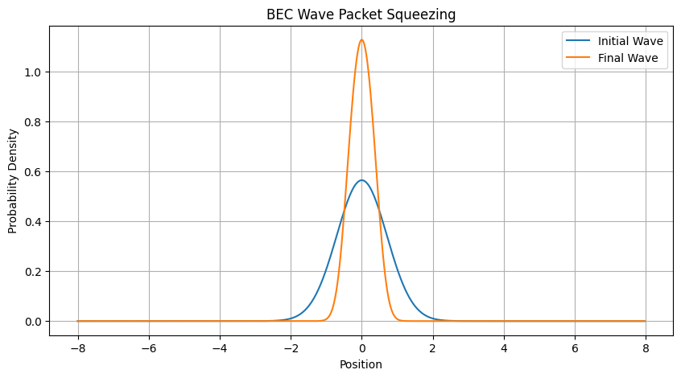
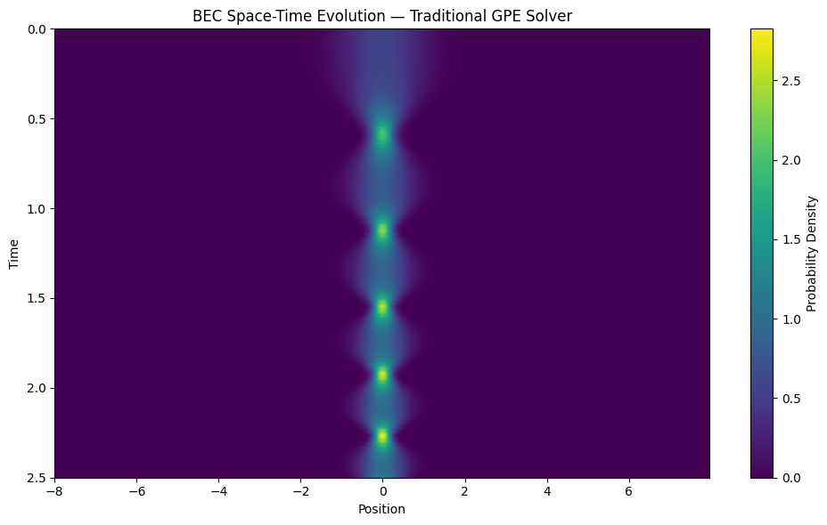
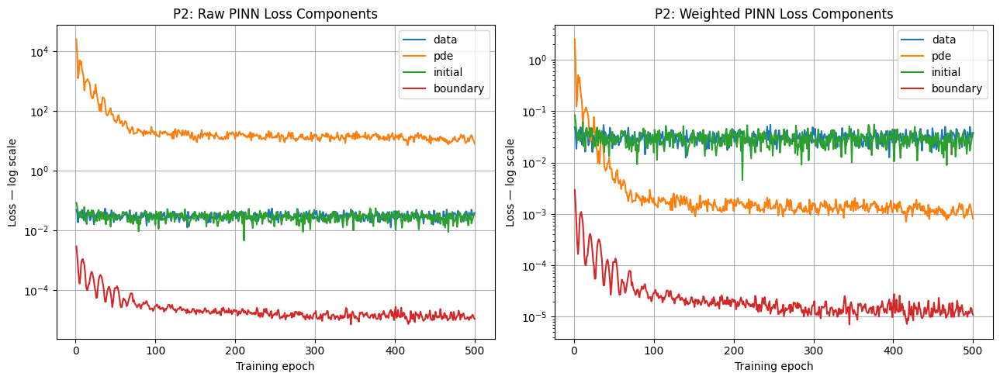
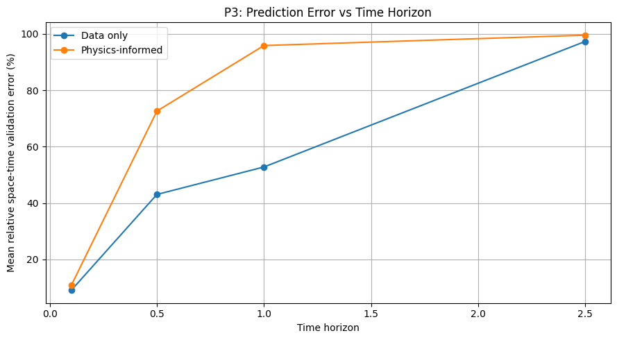
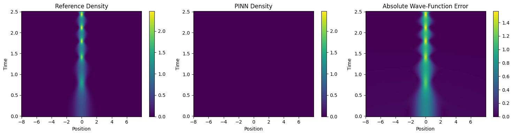
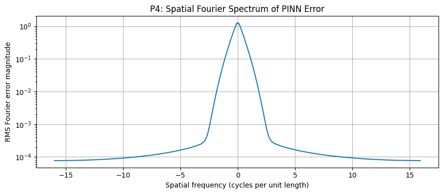
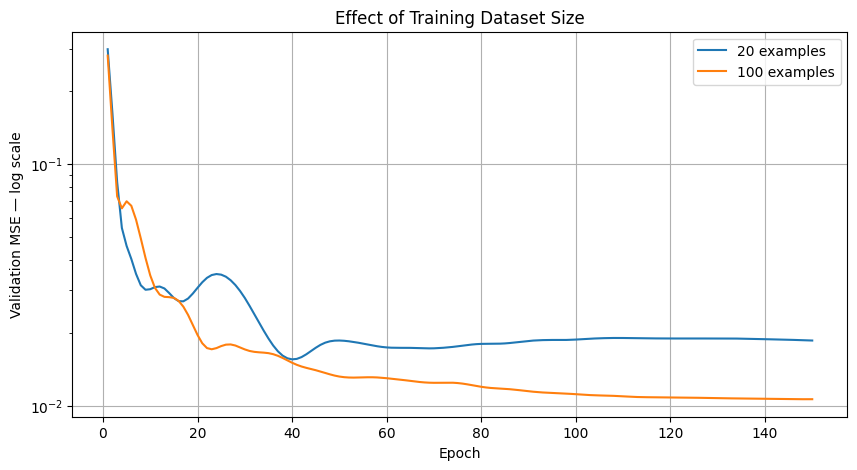
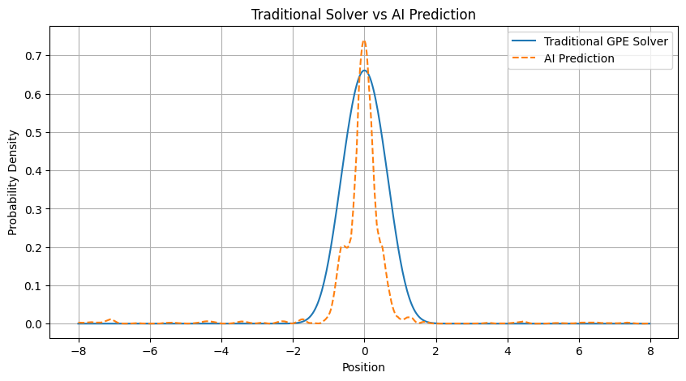

# MAE 598 Project 3: Diagnosing neural methods for BEC squeezing

**Path B: Diagnosis.** Report assembled October 28, 2026, from the team's final Colab notebook and supplied outreach account.

**Main finding.** The conventional Gross–Pitaevskii solver is numerically consistent under the tested refinements. A control-conditioned physics-informed space–time network fails on long trajectories, predicting nearly zero probability. A matched data-only network also struggles. Short trajectories are learned much more accurately. These experiments establish a duration-sensitive fitting failure under the tested budget, but do not isolate a unique underlying cause. A supplementary final-time FNO evaluates quickly but has substantial prediction error.

**Evidence boundary.** This report uses [Project3CodeSolution.ipynb](Project3CodeSolution.ipynb), copied unchanged from the supplied `ccnew.ipynb`. Measurements below are the notebook's saved outputs, not an independent retraining. Results from the separate DeepONet/Galerkin-related implementation are not included. Notebook cell positions below count all cells from one, including text cells; execution numbers can change.

## 1. Outreach and interview log

| Item | Team-supplied account / status |
|---|---|
| Researcher | Dr. Jimmie Adriazola; associated with ASU SMSS in the course candidate list. Current appointment was not independently verified for this report. |
| How identified | Course candidate-researcher table. |
| Interview | Zoom, October 16, 2026, according to the team's account. |
| Outcome | Proposed BEC control, provided a published model and squeezing/splitting examples, offered help, and requested results. |
| Initial contact and reservation | Exact date, method, and course-sheet reservation evidence were not supplied. |
| Written-brief review | Not confirmed. No researcher approval is claimed. |
| Follow-up and memo | Recommendation in Section 5 is an unsent draft; delivery and response are not confirmed. |
| Publication permission | Permission to publish attributed interview material was not supplied; confirm before making the interview account public. |

Interview statements are team-supplied paraphrases, not verified quotations or a transcript. The October 16 date does not establish compliance with the assignment's earlier interview milestone.

## 2. Researcher problem brief

### 2.1 Scientific problem and value

A Bose–Einstein condensate (BEC) is an ultracold atomic system whose mean-field dynamics can be modeled as a complex wave. Applications discussed in the supplied paper include precision measurement, quantum information, and quantum simulation. Preparing useful states requires changing a magnetic or optical trap while avoiding residual excitation.

Increasing the trap strength narrows the packet, but compression alone does not establish successful preparation: the wave can retain spatial phase error and continue breathing after the control ends. The practical goal is to reach a desired state efficiently and with little unwanted motion.

The team reports that Dr. Adriazola proposed comparing conventional optimal control against a learned control-to-solution map, with squeezing first and splitting as an optional extension. He described one-dimensional numerical solves as relatively inexpensive. The relevant possible value is reducing the cost of many repeated evaluations in optimization, rather than making one easy solve marginally faster.

### 2.2 Published approach and computational bottleneck

The supplied source is Adriazola and Goodman, [*A Reduction-Based Strategy for Optimal Control of Bose–Einstein Condensates*](https://arxiv.org/abs/2111.14266), supplied as a 2021 preprint. It reduces GPE dynamics through a Galerkin expansion, searches a CRAB sine-control family with differential evolution, refines using GRAPE-type descent, and checks the resulting controls in the full PDE. The paper reports roughly 30 seconds for its squeezing procedure on a 2.6 GHz six-core laptop and 3–5 minutes for splitting. These are paper measurements, not this project's measured full-PDE optimization cost or the researcher's current workflow.

The team reports that the researcher asked for a direct full-PDE comparison rather than reproduction of the reduction. Repeated solves, nonconvex control objectives, and preservation of phase and stationary-state behavior motivate the experiment. No previous neural-operator failure on this specific problem was described in the supplied interview account. The researcher's actual solver runtime/hardware, typical query count, and quantitative useful-accuracy threshold remain unconfirmed.

Success would require faster control decisions at comparable, independently solver-verified accuracy, including the cost of generating reference data and training. This report does not demonstrate that success.

## 3. Minimal-case formulation

### 3.1 PDE, domain, and states

We solve the dimensionless one-dimensional GPE with interaction coefficient fixed at one:

$$
i\partial_t\psi=-\frac12\partial_{xx}\psi+\frac12u(t)x^2\psi+|\psi|^2\psi.
$$

The computational domain is $x\in[-8,8)$, with periodic values and matching spatial derivatives. The reference solver uses $N=512$, $\Delta x=16/512$, $\Delta t=0.001$, and $T=2.5$. This Fourier box approximates an unbounded trapped system; no larger-domain convergence study is claimed for this notebook.

The initial condition is a real Gaussian, normalized on the grid:

$$
\psi(x,0)=C e^{-x^2/2},\qquad
\Delta x\sum_j|\psi(x_j,0)|^2=1.
$$

The Gaussian is a project simplification, not an established nonlinear ground state. The paper instead initializes from a superposition of even modes with coefficients selected through a reduced-Hamiltonian minimization. We keep the nonlinear full-PDE evolution, time-dependent confinement, and control-dependent complex-state prediction, while omitting the paper's reduction and splitting experiment.

The final target is an approximate nonlinear stationary state at $u=100$, computed with 10,000 normalized imaginary-time iterations of step 0.0005. Its relative stationary residual is $2.40644\times10^{-4}$; normalization is one. This supports an approximate numerical target, not proof of exact ground-state convergence. Imaginary-time-step refinement remains a limitation.

### 3.2 Controls and objective distinctions

The baseline is

$$
u_{\rm ramp}(t)=1+99t/T.
$$

The implemented smooth-control family is

$$
u(t)=1+99t/T+\sum_{n=1}^{3}a_n\sin(n\pi t/T),
$$

which preserves $u(0)=1$ and $u(T)=100$. Coefficient bounds do not enforce pointwise bounds on $u(t)$.

The paper's motivating objective combines terminal infidelity and $\int|\dot u|^2dt$. The notebook contains two distinct optimization experiments:

- An exploratory direct-GPE L-BFGS-B search uses infidelity plus $10^{-4}\int|\dot u|^2dt$, coefficient bounds $[-50,50]$, and at most 30 iterations. It is not the paper's reduced-model hybrid algorithm.
- The later traditional-versus-FNO comparison uses Powell, the same starting point and coefficient bounds $[-20,20]$, and the shared objective below:

$$
J_{\rm match}(a)=1-
\frac{|\langle\psi_d,\psi(T;a)\rangle|^2}
{\|\psi_d\|_2^2\|\psi(T;a)\|_2^2}
+10^{-5}\sum_{n=1}^{3}a_n^2.
$$

Its regularizer penalizes coefficient magnitude, not $\dot u$. These objectives are not interchangeable. We do not combine their objective values or claim physical stationarity from narrow density alone.

### 3.3 Models, data, and difficulty knob

The main physics-informed model is a **control-conditioned coordinate PINN**, not a DeepONet or the supplementary FNO. Inputs are $(x,t,a_1,a_2,a_3)$; outputs are real and imaginary wave components. It has three width-64 Tanh hidden layers and 8,834 trainable parameters. Inputs scale as $x/8$, $2t/T-1$, and $a/20$.

The main space–time reference set uses 20 training controls and five separate validation controls, each with 101 times and 512 spatial positions. Whole controls, rather than individual points from the same control, are separated between training and validation. Reference generation took 10.79 seconds.

The supplementary FNO-style final-state model uses two spectral/local layers with width 32 and 16 Fourier modes, with 35,106 parameters. Thirty original controls are split 20/5/5; 80 additional controls expand training to 100 while preserving the validation cases. The five nominal test controls were repeatedly inspected and are therefore **exploratory**, not a fresh final holdout. Controls are sampled in $[-20,20]^3$.

**Difficulty knob:** training and evaluation horizon $H\in\{0.1,0.5,1.0,2.5\}$. Each experiment sees a longer prefix of the same reference trajectories; $T=2.5$ remains in the control formula and input scaling. Short runs do not compress the full 1-to-100 ramp. Thus horizon changes both duration and the portion of the trapping evolution encountered. It is a controlled family-difficulty study, not isolation of elapsed time from confinement or oscillation complexity.

## 4. Experiments and findings

### 4.1 P1: conventional baseline and numerical consistency

The solver applies potential/nonlinear half-steps around a full Fourier kinetic step, with the potential evaluated at time midpoints. It propagates complex waves without real-time renormalization.

The baseline RMS width decreases from 0.7071 to 0.3355, a 52.56% reduction. The width diagnostic is the second moment about zero; the centered, even setup makes this consistent with a centered width. Squeezing is not equivalent to high target fidelity.





Refinement checks cover the linear ramp and five validation controls. Time refinement halves the step at $N=512$; spatial checks compare 512, 1,024, and 2,048 points at the finer step.

| Case | Time-refinement complex-wave difference (%) | Density difference against refined solve (%) | 512-point evolution time (s) |
|---|---:|---:|---:|
| Linear baseline | 0.003250 | 0.001131 | 0.536788 |
| Validation 1 | 0.002889 | 0.002110 | 0.288587 |
| Validation 2 | 0.007970 | 0.001191 | 0.256518 |
| Validation 3 | 0.001836 | 0.002080 | 0.251989 |
| Validation 4 | 0.004145 | 0.000926 | 0.253667 |
| Validation 5 | 0.004086 | 0.002591 | 0.261058 |

Spatial differences round to 0.000000% at the displayed precision; they are not established as exactly zero. These are refinement differences, not rigorous exact-solution error bounds. Their small size relative to neural errors supports the solver as a reference for these cases. Evolution-loop timing excludes setup and differs from later end-to-end solver timings.

### 4.2 P2: physics-informed losses and training

Writing $\psi=p+iq$, the implemented residual components are

$$
r_1=-q_t+\tfrac12p_{xx}-Vp-(p^2+q^2)p,\qquad
r_2=p_t+\tfrac12q_{xx}-Vq-(p^2+q^2)q.
$$

The training objective is

$$
L=L_{\rm data}+10^{-4}L_{\rm PDE}+L_{\rm IC}+L_{\rm BC},
\qquad L_{\rm PDE}=\mathrm{mean}(r_1^2+r_2^2).
$$

Data/IC terms compare real and imaginary components. The periodic boundary term compares values and first spatial derivatives at $-8$ and $8$. Each update samples 256 data points, 256 residual points, 64 initial points, and 64 paired boundary points. Spatial sampling is uniform over the full box. There is no norm penalty or hard initial-condition constraint. Automatic differentiation acts in physical coordinates, including the input scaling.

Adam uses learning rate 0.001 for 500 updates. Every 50 updates, and at update one, a fixed 2,048-point validation sample is evaluated; the best sampled-validation checkpoint is retained. The raw PDE loss initially exceeds the other losses by many orders of magnitude. Its multiplier is a heuristic fixed scaling, not a researcher-approved or optimized choice.



The saved training log reduces the raw PDE loss from about $2.49\times10^4$ to 8.085 and boundary loss from 0.002931 to about $1.09\times10^{-5}$. Yet full space–time validation error is 99.54%. The low residual is not evidence of a correct state.

### 4.3 P3: accuracy versus time horizon

Errors are relative discrete complex $L^2$ errors over each complete sampled space–time grid, averaged across five validation controls. No post-hoc phase alignment or normalization is applied to these reported errors. Uniform grid factors cancel in each ratio. The same controls, architecture, initial weights, scaling, learning rate, data batches, and 500 updates are used at every horizon. Physics-informed and data-only models differ in whether PDE, IC, and BC losses are added. Final checkpoints are evaluated here, rather than the validation-selected checkpoints used in the main experiment.

| Horizon | Data-only error (%) | Physics-informed error (%) | Data-only mean probability | Physics-informed mean probability |
|---|---:|---:|---:|---:|
| 0.1 | 9.0913 | 10.8135 | 0.9720 | 0.9508 |
| 0.5 | 43.0598 | 72.6076 | 0.7121 | 0.3016 |
| 1.0 | 52.8016 | 95.8485 | 0.6419 | 0.0417 |
| 2.5 | 97.2959 | 99.5200 | 0.0459 | 0.0023 |



Both approaches deteriorate as this family becomes more demanding. The physics-informed model is worse at intermediate horizons and approaches zero probability at the longest horizon. This establishes sensitivity under a fixed training budget; it does not prove a causality violation or isolate temporal frequency, sample density, and optimizer effects.

### 4.4 P4: where the error occurs

The first validation trajectory is used for the full space–time visualization. Reference and predicted densities share a color scale; the third panel shows absolute complex-wave error. The spectrum is the RMS spatial Fourier magnitude of the **complex error**, averaged over saved times across the full box, with FFT scaling by $\Delta x$. It is not a comparison of solution spectra.





Main PINN probability ranges remain between approximately zero and 0.0227, compared with reference probability one. The zero wave satisfies the homogeneous GPE and periodic boundaries. The observed near-zero output explains how low residuals coexist with a missed condensate; it does not establish why optimization selected that output. An error spectrum alone cannot establish spectral bias.

### 4.5 Controlled diagnosis and supplementary experiments

**Physics-informed versus data-only fitting.** The data-only coordinate network starts from the same weights, uses the same architecture, controls, 256-label batch size, learning rate, update count, and validation checkpoint schedule. Random data samples differ after the first iteration because the main PINN consumes additional random draws. The horizon sweep later uses explicitly matched data batches.

| Main model | Training wave error (%) | Validation wave error (%) | Mean training probability |
|---|---:|---:|---:|
| Physics-informed | 99.4451 | 99.5413 | 0.0023 |
| Data only | 96.6369 | 97.3898 | 0.0602 |

Both struggle even on training controls. Generalization alone is therefore insufficient as an explanation. Removing physics terms does not restore accurate long-horizon fitting. Because PDE, IC, and BC contributions change together, this is not an isolated PDE-weight or boundary-weight ablation. Short-horizon success shows that this architecture/training setup can learn an easier member of the family, but does not prove adequate expressivity for the full trajectory.

**FNO dataset-size comparison.** Identical initial weights and 150 Adam updates give validation error 74.41% with 20 training examples and 55.16% with 100. Validation MSE falls from 0.018626 to 0.010653. This supports a data-size contribution to this separate model's error; it does not diagnose the coordinate PINN. Only five validation controls and one initialization are used.



The 100-example FNO has 65.75% mean final-time wave error on five exploratory cases. Aligning global phase leaves large errors. Normalizing predictions to unit probability increases mean relative density error from 50.28% to 55.14%, so amplitude rescaling alone is insufficient.



**Preliminary control optimization record.** The notebook retains a matched-objective search with solver-verified density errors 0.253400 (traditional) and 0.254834 (FNO-selected), and objectives 0.052612 versus 0.122382. Search times were 121.88 s and 0.21 s, with 323 versus 104 evaluations. This saved output predates the later FNO retraining in the interactive workflow. It is a preliminary record, not a freshly reproduced benchmark of the final 100-example checkpoint. The accompanying control-limit and post-hold outputs also include older saved runs. They are not used to claim final stationarity, a globally optimal control, or an accuracy-qualified speedup.

**Bounded Path B conclusion.** The main result is a duration-sensitive fitting failure, with near-zero physics-informed outputs and poor data-only long-horizon fits. The comparisons separate pure unseen-control generalization from an inability to fit the training family. They do not identify a unique lower-level mechanism. A stronger root-cause diagnosis would require additional targeted controls; none are claimed here. This is a negative finding with an explicitly incomplete mechanism diagnosis, not a demonstrated Path C remedy.

### 4.6 P5: computational cost and hardware

The final record reports Linux x86-64, PyTorch 2.11.0+cpu, CPU execution, and one PyTorch CPU thread. A specific CPU model was not captured. Original notebook imports report NumPy 2.1.3 and SciPy 1.16.3; other package versions were not recorded.

| Main experiment | Training (s) | Full space–time validation error (%) |
|---|---:|---:|
| Physics-informed coordinate model | 10.9225 | 99.5413 |
| Data-only coordinate model | 1.0243 | 97.3898 |

Reference-trajectory generation took 10.79 s for 20 training and five validation controls. Those costs are separate from training; generating data is not free.

| Horizon | Data-only training (s) | PINN training (s) | Data-only evaluation (s) | PINN evaluation (s) |
|---|---:|---:|---:|---:|
| 0.1 | 2.9854 | 9.2245 | 0.0360 | 0.0242 |
| 0.5 | 1.4434 | 12.0059 | 0.2385 | 0.2000 |
| 1.0 | 1.5193 | 9.1529 | 0.3566 | 0.1597 |
| 2.5 | 1.0697 | 9.4951 | 0.4257 | 0.3753 |

Evaluation here covers five trajectories and includes building query batches and computing validation metrics. It is not a single-point latency measurement or an isolated forward-pass timing. Horizon runs share reference trajectories; their data-generation cost is not charged eight times. These are observed run times, not statistically replicated benchmarks.

**Supplementary final-time FNO cost, from the final notebook summary:**

| Quantity | Recorded result |
|---|---:|
| Mean full conventional final-state solve | 0.865068 s |
| Mean FNO forward prediction | 0.001127 s |
| Recorded inference speed ratio | 767.83× |
| Original + additional data generation + 100-example training | 67.23 s |
| Mean exploratory final-time wave error | 65.75% |
| Timing-only integer break-even | 78 queries |

The solver is timed five times. The model uses five warmups and 20 timed forward calls. Data transfer/setup and model loading are not an end-to-end deployment benchmark. The break-even estimate is

$$
Q_* = \left\lceil\frac{t_{\rm data}+t_{\rm training}}
{t_{\rm solve}-t_{\rm inference}}\right\rceil.
$$

Using displayed values, $\lceil67.23/(0.865068-0.001127)\rceil=78$. The displayed speed ratio differs slightly if recomputed from rounded times. Setup excludes earlier failed experiments, hyperparameter searches, reporting, and control verification. At 65.75% wave error this is a timing-only benefit, not an accuracy-qualified replacement recommendation. The PINN predicts whole trajectories and the FNO only final states, so their error percentages and query times cannot be compared as identical tasks. Earlier timing cells report other run measurements; the final summary above is the report's selected FNO timing record.

## 5. Recommendation memo — unsent draft

**To:** Dr. Jimmie Adriazola  
**From:** MAE 598 Project 3 team  
**Date:** October 28, 2026  
**Subject:** Retain the conventional GPE solver; investigate short-window neural training

We investigated your proposed use of learned models to accelerate repeated BEC control evaluations. Our minimal case solves the full dimensionless one-dimensional GPE for squeezing in a quadratic trap. We recommend retaining the conventional solver for control decisions at this stage.

The numerical reference was consistent under the tested time/grid refinements: maximum time-refinement wave difference was below 0.008%, and density differences against the refined solve were below 0.0026%. Our initial state is a normalized Gaussian, so this is a simplified case rather than an exact reproduction of your paper.

A control-conditioned PINN reduced its PDE residual but achieved 99.54% space–time validation error and predicted nearly zero probability. An otherwise matching data-only model also failed to fit the long trajectories. In a horizon sweep using matched data samples and fixed 500-update budgets, physics-informed error rose from 10.81% at horizon 0.1 to 99.52% at 2.5. These results identify sensitivity to the trajectory family and training budget, but do not isolate causality, spectral bias, or optimization conditioning as the cause.

A separate supervised FNO predicted final states much faster than numerical integration, but mean exploratory wave error remained 65.75%. Its timing-only break-even estimate of 78 queries is therefore not evidence of useful optimization acceleration. Earlier control-selection outputs remain preliminary and need refresh against the final model.

We suggest a matched comparison of short-window and full-horizon training, followed by evaluation on fresh controls and numerical verification of any selected controls. Your useful fidelity/stability tolerance and actual query workload would help determine whether the added training cost could be justified. We would also welcome corrections to the written problem brief.

**Delivery status:** draft only. No memo transmission, response, or written-brief approval is claimed by this report.

## 6. Assumptions and limitations

- Dimensionless, one-dimensional mean-field GPE with harmonic confinement, fixed interaction coefficient, even Gaussian initialization, and a finite periodic box. No splitting, singular barrier, finite-temperature model, 3D geometry, or experimental noise is simulated.
- A Gaussian initial state is not the nonlinear ground state. The target is approximate, and no imaginary-time-step or box-size refinement is reported for it.
- Controls use three sine coefficients. Bounds on coefficients do not enforce hardware limits on the resulting control. Local optimizer convergence is not global optimality.
- Main models use one initialization and small control splits. Five validation controls and repeatedly inspected exploratory cases do not provide population-level uncertainty or a fresh final accuracy estimate.
- Longer prefixes include different trap strengths and dynamics, with the same number of updates and sampled points. The horizon experiment cannot attribute degradation uniquely to duration, frequency, sampling, representation, or optimization.
- Near-zero predictions satisfy the PDE/periodic conditions but violate the desired nonzero state. Soft data/IC penalties did not prevent this. No successful fix or unique root cause is established.
- Global-phase-sensitive wave errors, phase-invariant fidelity, and density errors answer different questions; they are not interchangeable. FNO final-time and PINN space–time errors are separate tasks.
- Saved notebook outputs came from an interactive session. Older control/hold and timing outputs are not silently substituted into final-model conclusions. This assembled report has not independently retrained the models or completed a clean Colab rerun.
- The researcher's current hardware, workload, useful accuracy threshold, written-brief review, and publication permission remain unconfirmed. Interview and delivery statuses are not inferred from public papers.

## 7. Reproduction and submission status

### 7.1 Run the notebook

1. Open [Project3CodeSolution.ipynb](Project3CodeSolution.ipynb) in Google Colab using **File → Open notebook → GitHub**, or upload it directly.
2. Use a fresh CPU session. Install NumPy, SciPy, pandas, Matplotlib, and PyTorch if unavailable. Recorded versions include NumPy 2.1.3, SciPy 1.16.3, and PyTorch 2.11.0+cpu; these do not guarantee identical outputs on another runtime.
3. Run all cells from top to bottom. The space–time verification cell belongs after trajectory preparation, as in the packaged notebook. Do not rerun model-definition cells between training and evaluation.
4. The notebook regenerates synthetic `.npz` data, trains the FNO/PINN/data-only models, runs refinement and horizon experiments, and writes CSV/PNG files. It does not require unpublished researcher data.
5. Allow several minutes. The saved traditional search alone took about two minutes; total wall time is machine dependent and was not measured as one clean run.
6. Before final submission, replace the working notebook's stale saved outputs through a clean run and synchronize any changed report numbers. Preserve the submitted source copy before editing.

Randomness is set separately: seed 42 for original data/splits and FNO initialization, 2026 for extra controls, 123 for main PINN/data-only sampling, and 456/789 for matched horizon data/physics streams. Main coordinate models use seed-42 initial weights. These controls do not ensure cross-platform bitwise reproducibility. Learned checkpoints and raw prediction arrays were not supplied as separate files.

### 7.2 Transparent arithmetic checks

An analytic reference check is the initial Gaussian: on the real line $C=\pi^{-1/4}$ and $\sigma=\sqrt{\int x^2|\psi|^2dx}=1/\sqrt2\approx0.707107$, agreeing with the recorded initial width. From the rounded widths, $100(0.7071-0.3355)/0.7071\approx52.55\%$; the notebook's 52.56% uses unrounded grid values. The FNO timing-only break-even arithmetic above also rounds up to 78 queries.

The assignment additionally asks for a manual check of an actual neural error. Its saved percentage is not an independent manual check: the raw norms were not included with the notebook. After running the PINN evaluation, use this small check in the live session, then record the two norms and their hand-calculated ratio:

```python
reference = trajectory_val_waves[0]
prediction = pinn_validation_predictions[0]
numerator = np.sqrt(np.sum(np.abs(prediction - reference)**2))
denominator = np.sqrt(np.sum(np.abs(reference)**2))
print("Error numerator:", numerator)
print("Reference denominator:", denominator)
print("Relative error (%):", 100 * numerator / denominator)
```

This should reproduce the first PINN case's error for the current run, not necessarily a historical rounded value. **A completed human check is not claimed here.**

### 7.3 Requirements and remaining human actions

| Requirement | Location / status |
|---|---|
| Outreach and interview | Section 1; team-supplied account, some dates/evidence unavailable |
| Researcher problem brief | Section 2; written review not confirmed |
| Mathematical formulation, path, knob | Section 3 |
| P1 baseline | Section 4.1; refinement consistency measured |
| P2 loss histories | Section 4.2 |
| P3 difficulty sweep | Section 4.3 |
| P4 space–time error and error spectrum | Section 4.4 |
| P5 cost and hardware | Section 4.6 |
| Controlled Path B findings | Section 4.5; unique underlying mechanism unresolved |
| Recommendation | Section 5; unsent draft |
| Assumptions and limitations | Section 6 |
| Runnable source and instructions | Notebook and Section 7; clean-run execution still to be confirmed |

Before submission, the team must confirm author roster and researcher-attribution permission, complete the manual neural-error check and clean run, send the recommendation memo, record delivery/any response truthfully, review public GitHub contents, and submit the repository URL on Canvas. A negative result is allowed, but the instructor must assess whether the bounded diagnosis satisfies Path B's mechanism requirement.

## References and provenance

1. J. Adriazola and R. H. Goodman, [*A Reduction-Based Strategy for Optimal Control of Bose–Einstein Condensates*](https://arxiv.org/abs/2111.14266), supplied 2021 preprint, especially Equations (2)–(5), Section II.A, and Equation (21).
2. Team-supplied outreach log and problem brief: interview reported October 16, 2026; no independent transcript or approval provided.
3. [Final notebook](Project3CodeSolution.ipynb), supplied as `ccnew.ipynb`; figures are extracted unchanged from saved image outputs. This report does not import the separate DeepONet implementation's results.
